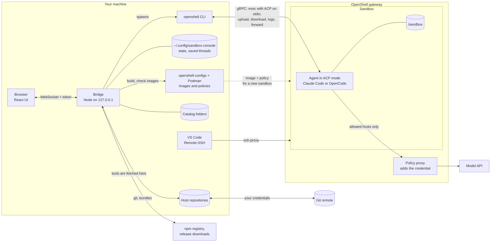
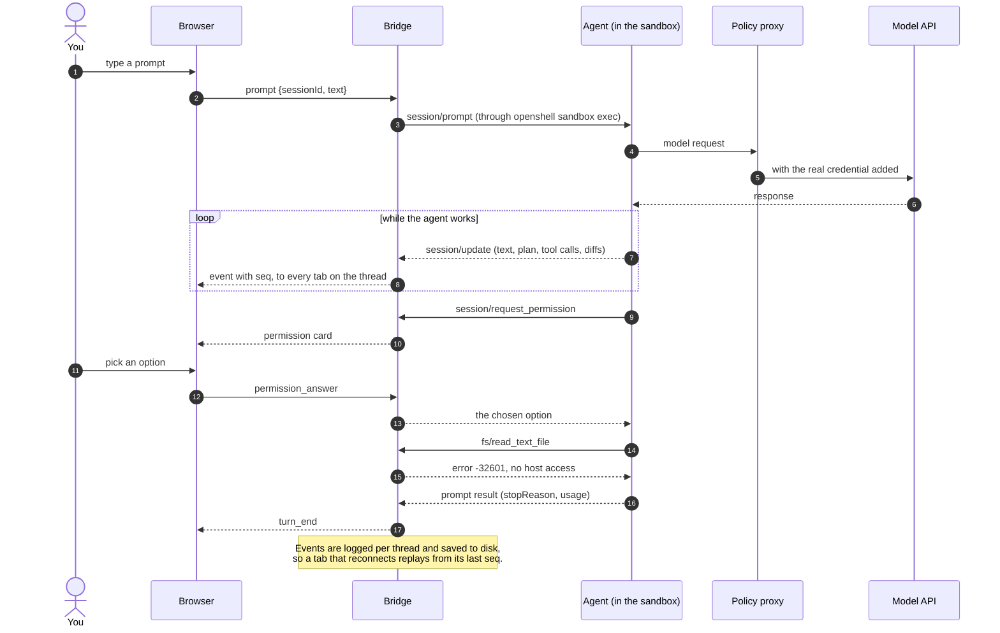
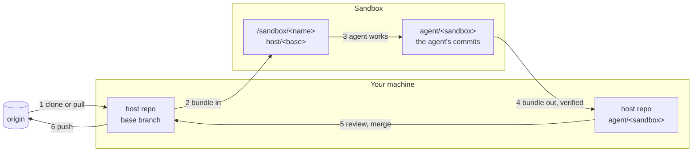
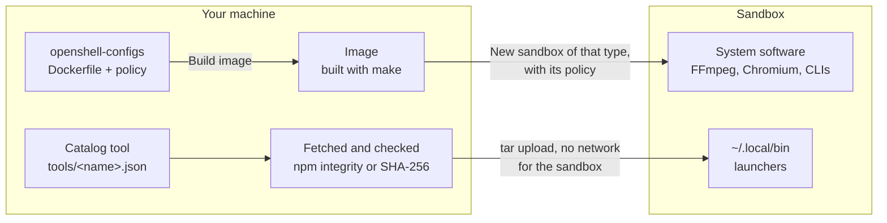

# Sandbox Console

A local web app for the coding agents in your [OpenShell](https://github.com/NVIDIA/OpenShell) sandboxes. It lists your sandboxes and lets you chat with the agent in each one over [ACP](https://agentclientprotocol.com) (Agent Client Protocol). The agent stays inside its sandbox. The console shows what it does and asks you before it acts.

- **All sandboxes at a glance:** each one shows whether its agent is working, waiting for you, or idle. Sandboxes waiting for you sort to the top.
- **Chat:** streamed replies, the agent's plan, its thinking, and a card for each tool call, with diffs for edits.
- **Approvals:** permission requests appear as cards. You answer with the agent's own options, each labelled with what it actually does.
- **Models and commands:** a searchable model picker (OpenRouter offers about 400 models) and a `/` menu with the agent's commands.
- **Sessions keep running** when you close the tab, and the conversation is replayed when you come back. A sandbox can have several threads (conversations) side by side, and threads are saved, so they survive a restart and can be resumed or deleted.
- **Repositories:** bring a repository in (clone a URL or use a folder on this machine), get the agent's commits out, review the diff, merge into your branch and push. Only git bundles cross into the sandbox; credentials stay on this machine.
- **Catalog:** add agents, skills, context files and command-line tools to a sandbox with one click.
- **Sandbox types:** create a plain Claude Code or OpenCode sandbox, or one with a browser or HyperFrames, from images built on this machine, each with its own network policy.
- **VS Code:** open a sandbox folder in VS Code (or Cursor) over Remote-SSH through the gateway.
- **Ports:** forward a port of the sandbox to this machine, to open what the agent serves (the HyperFrames Studio, a dev server) in your browser.
- **Activity:** hosts the sandbox reached or was denied, and what the agent was always allowed.

The design is in [docs/DESIGN.md](docs/DESIGN.md), and [docs/mockup.html](docs/mockup.html) is a clickable mockup.

## Requirements

- Node 22 or later, and git.
- `openshell` on your PATH, with a running gateway (`openshell status`).
- Images, policies and providers from [openshell-configs](https://github.com/fredrikp999/openshell-configs), checked out on this machine (the console looks in `~/openshell-configs/openshell-configs`, or set `OPENSHELL_CONFIGS`): the `claude` provider for Claude Code and/or `openrouter` for OpenCode. Images can be built from the console's New sandbox dialog, with Podman (or Docker with `ENGINE=docker`).
- Optional: VS Code (or Cursor) with the Remote-SSH extension.

## Quick start

```sh
git clone https://github.com/fredrikp999/sandbox-console.git
cd sandbox-console
./console.sh
```

`./console.sh` installs dependencies when they've changed, builds the UI, starts the bridge on `127.0.0.1:7801` and opens the console in your browser. It prints the address too:

```
Sandbox Console is running.

  http://127.0.0.1:7801/#token=…
```

The token is new each time the bridge starts. The page moves it out of the address bar and keeps it in the browser, so reloads and new tabs work. After a restart, open the new address.

Other ways to start it:

```sh
./console.sh --port 7900 --no-open   # another port, don't open the browser
npm start                            # build and start, don't open the browser
```

### Try it without a gateway

```sh
OPENSHELL_BIN=test/fixtures/fake-openshell.mjs ./console.sh
```

This uses a fake `openshell` with a scripted agent:
- **Normal prompt:** the agent shows a plan, makes an edit with a diff, asks permission to run a command, and makes a host file request that the console refuses.
- **Prompt containing "fail":** the agent returns an API error, so you can see how errors are shown.
- **`claude-demo`:** shows the error for an image without the ACP adapter.

## Using it

**Sandboxes (left).** Click a sandbox to open it.
- **No agent session yet:** pick the agent if the console can't tell which one the sandbox has, then the working directory, then **Start session**.
- **New sandbox:** pick a type, then a name. It's created the same way `sandbox.sh` does: it runs `sleep infinity`, gets the type's policy, and stays around until you delete it. See "Installing software" below.

**Conversation (middle).**

| Key | |
|---|---|
| <kbd>Enter</kbd> | send |
| <kbd>Shift</kbd>+<kbd>Enter</kbd> | new line |
| <kbd>Esc</kbd> | stop the agent |
| <kbd>/</kbd> | command menu |

The `/` menu has the agent's own commands (OpenCode: `/init`, `/review`, …) and three console commands:

| Command | |
|---|---|
| `/model [search]` | switch model for this session |
| `/bundle [dir]` | download the agent's commits as a git bundle |
| `/new` | start another thread in this sandbox |

Anything else starting with `/` isn't sent, because it would reach the model as plain text. Start with a space to send it anyway.

**Permission cards.** When the agent asks before acting, answer with one of its options. Each button also shows what it does ("allows once", "allows always", "rejects"), because the label is the agent's own text. Stop (<kbd>Esc</kbd>) answers an open request with "cancelled".

**Where things are.** The header is about the sandbox, the tabs and conversation about a thread, the right column about the code.
- **Hiding the side panels:** the buttons at the left and right ends of the header, or <kbd>⌘B</kbd> / <kbd>Ctrl</kbd>+<kbd>B</kbd> for the sandboxes and <kbd>⌥⌘B</kbd> / <kbd>Ctrl</kbd>+<kbd>Alt</kbd>+<kbd>B</kbd> for the right column. The browser remembers what you hid. In a narrow window the right column opens over the conversation (<kbd>Esc</kbd> or a click outside closes it).
- **Header:** the sandbox name; agent, directory and context used (hover for the agent command, session id and token totals); the model; **Open in VS Code** (▾ picks the folder, or Cursor; see below); **Ports** (see below); and **⋯** with **Stop the agent** and **Delete sandbox**.
- **Threads:** the tabs above the conversation. Each is its own ACP session with its own history, model and pending approvals, so one can wait for you while another works. × closes a tab; the thread stays in the sidebar.
- **Sidebar:** under the selected sandbox, all its threads (open one, or delete it), and **Earlier from the agent…**: sessions the agent itself keeps, loaded with `session/load` as another thread.
- **Changes** (right): the repository as four steps (in the sandbox, the agent's work, review, on origin), with the next one highlighted; see below. Under it, the files this thread edited (click one to jump to the edit).
- **Catalog** (right): agents, skills, context files and tools to add to the sandbox, in sections that open with a click (a filter opens the ones that match); see below.
- **Activity** (right): network this session, from `openshell logs` (the tab shows how many hosts were denied), and what the agent was always allowed.

**VS Code.** Needs the [Remote-SSH](https://marketplace.visualstudio.com/items?itemName=ms-vscode-remote.remote-ssh) extension and the `code` command (in VS Code: *Shell Command: Install 'code' command in PATH*; the console also looks in `/Applications`).
- **How it connects:** over SSH through the gateway (`openshell ssh-proxy`); the sandbox exposes no port. The host entry `openshell-<sandbox>.default` lives in `~/.config/openshell/ssh_config`, which OpenShell includes from `~/.ssh/config`. The console adds a missing entry there; on a machine where that was never set up, it lets `openshell sandbox connect --editor vscode` do it the first time.
- **VS Code Server:** the sandbox can't download it, so VS Code needs `"remote.SSH.localServerDownload": "always"`. The console tells you when it's missing and can add it.
- **Terminal:** the sandbox needs the terminal policy (`policies/vscode-terminal.yaml`, which "New sandbox" uses); the console warns when it's missing.

**Ports.** Opens what the agent serves in the sandbox in your browser, with `openshell forward`. The port is the same on this machine and in the sandbox, and is bound to 127.0.0.1 only. The button shows how many ports are forwarded.
- **Forwarded:** each port with a link to open it, and **Stop**. It says when nothing listens on that port in the sandbox yet.
- **Presets** from `server/ports.json`: the HyperFrames Studio (3002) and common dev servers (Vite 5173, 3000, 8000, 8080). A preset can be limited to some sandbox types with `"types"`. Each says whether something runs on it in the sandbox, and how to start it if not.
- **Open in the sandbox:** the ports something listens on, with the program behind each when it can be told from its command line (the sandbox doesn't let one process see another's sockets). High ports (32768 and up) are usually the agent's own and are folded away.
- **Another port:** any port from 1024 to 65535.
- **A port in use on this machine** is refused before anything starts, with the program that has it (e.g. a HyperFrames Studio started on the host).
- Forwards keep running when the console stops (`openshell forward list`, `openshell forward stop <port> <sandbox>`), and are stopped when the sandbox is deleted.

**Working on a repository.** The **Changes** tab does what openshell-configs' `bundle.sh` does, plus the host side around it.
- **Bring into sandbox:** give a URL (`git@github.com:you/app.git`, `https://…`) or a path on this machine (`~/code/app`). A URL is cloned here, into `~/sandbox-repos/<name>` unless you choose a directory, with your own git credentials. The base branch (origin's default unless you name one) goes into the sandbox as a git bundle: `/sandbox/<name>`, on branch `agent/<sandbox>`. New sessions in that sandbox start in that directory.
- **Send latest:** pulls the base branch from origin here (fast-forward only; local commits are never rewritten), then sends it into the sandbox as `host/<base>`. Ask the agent to merge or rebase it.
- **Get changes:** the commits on `agent/<sandbox>` that aren't in `host/<base>` come out as a bundle and are fetched into your repo as branch `agent/<sandbox>`. The review opens.
- **Review:** the commits and the diff of each file, `<base>...agent/<sandbox>`.
- **Merge into `<base>`:** a fast-forward if `<base>` hasn't moved, otherwise a merge commit. If `<base>` is checked out, that work tree must have no uncommitted changes and is updated; if not, only the branch moves. On conflicts nothing changes: send the latest base in and let the agent merge it. After a merge the base is sent into the sandbox again.
- **Push `<base>` to origin:** a separate button, after the merge.
- **What the sandbox gets:** only bundles of the base branch. No other branches, no remote, no credentials. Git with credentials runs only on this machine, and never prompts (a prompt would hang): use SSH keys in ssh-agent or a credential helper.
- **Unlink** forgets the link. No files are deleted.

**Installing software.** The sandbox user isn't root and `/usr` is read-only, and the sandbox can't reach package registries. Opening one "just for the install" would open it to the agent too: the network rules tell programs apart by their binary, and npm, most CLIs and Claude Code are all `node`. So software comes in one of two ways, and the agent never gets a registry or download site:
- **Sandbox types** (in New sandbox) for anything that needs system packages, a browser or its own network rules. A type is an openshell-configs image, built on this machine from its Dockerfile, plus the policy that goes with it: Claude Code, Claude Code + browser (`claude-browser`, `policies/browser.yaml`), Claude Code + HyperFrames (`claude-hyperframes`, `policies/hyperframes.yaml`: the HyperFrames CLI, FFmpeg, fonts, Chromium and the skills), and OpenCode. The dialog shows which images are built; **Build image** runs `make <image>` in openshell-configs and shows its output, and keeps going if you close the dialog. A sandbox's image is fixed when it's created, so for HyperFrames you create a HyperFrames sandbox. Types are in `server/sandbox-types.json`.
- **Tools** (in the Catalog) for command-line programs that run as the sandbox user: an npm package at an exact version, or a binary with its SHA-256. They're fetched here on the host for the sandbox's CPU and C library (npm with `--ignore-scripts --os=linux --cpu=… --libc=…`, which also checks the registry's integrity hashes) and copied in. Packages that would have to be compiled are refused; packages whose install scripts weren't run are named. A tool lives in `~/.local/share/sandbox-console/tools/<name>`, with a launcher per command in `~/.local/bin`. The console starts agents with `~/.local/bin` on `PATH` and adds it to `~/.profile` and `~/.bashrc` for the VS Code terminal. An existing command in `~/.local/bin` that the console didn't put there is never replaced.

**Catalog.** Agents, skills, context files and tools on this machine, to add to a sandbox with one click.
- **Where they come from:** your catalog folder (`~/.config/sandbox-console/catalog`, with `agents/<name>.md`, `skills/<name>/SKILL.md`, `context/<name>.md` and `tools/<name>.json`), the examples in [`catalog/`](catalog), and the skills and agents you already have in `~/.claude`, `~/.agents` and `~/.config/opencode`. If a name is in more than one, the first wins.
- **Where they go:** where the sandbox's agent looks, in its home (`/sandbox`). Claude Code: `~/.claude/agents/`, `~/.claude/skills/` and `~/.claude/CLAUDE.md`. OpenCode: `~/.config/opencode/agents/`, `~/.config/opencode/skills/` and `~/.config/opencode/AGENTS.md`.
- **Agents** are written in Claude Code's format (`name`, `description`, `tools`) and rewritten for OpenCode (`mode: subagent`, with `edit`, `bash` and `webfetch` denied when `tools` leaves them out). The model isn't carried over, since the two name models differently.
- **Context files** are added to the agent's global instructions between `<!-- sandbox-console:begin <name> -->` and `…:end <name> -->` lines. What else is in that file stays as it is, and **×** takes only that block out.
- **Updates:** an item shows **Update** when the catalog's copy changed since it was added, and **Replace** when the sandbox has its own item of that name.
- **When it applies:** new threads pick it up. A running thread may not until the agent restarts (⋯ → Stop the agent).
- **Tools** are described in a JSON file. `{"description": "…", "npm": "prettier@3.9.10"}`, or for a binary `{"binary": "jq", "downloads": {"linux-arm64": {"url": "https://…", "sha256": "…"}, "linux-x64": {…}}}`, with `"path"` inside an archive (`.tar.gz`, `.tar.xz`, `.zip`) when the download is one. The built-in ones are jq and Prettier.
- **Limits:** skills skip dotfiles, `.git` and `node_modules`, and can be up to 10 MB. Tools can be up to 300 MB.

**Getting code out without a linked repository.** Have the agent commit, then use "download the agent's commits as a git bundle" in the Changes tab (or `/bundle <dir>`).
- **What's in it:** the commits on the current branch of the session's directory that aren't in `host/main` or `host/master`. Those branches exist when the repo came in through openshell-configs' `bundle.sh in`; without them, the whole branch.
- **Taking it into your repo:** `git fetch <file> <branch>:<branch>`, then review before you push.

## Architecture

The console has two parts on your machine. The **bridge** is a small Node server on 127.0.0.1. It holds the agent sessions, talks to OpenShell through the `openshell` CLI, and does the host-side work (git, the catalog, image builds). The **UI** is a React app in your browser, connected to the bridge over one WebSocket per tab.

Each agent runs inside its sandbox. The bridge starts it with `openshell sandbox exec` and speaks [ACP](https://agentclientprotocol.com) (JSON-RPC) to it over that command's stdin and stdout, which the CLI carries to the sandbox over the gateway's gRPC connection. There is one agent process per sandbox; each thread is an ACP session on it. The agent's own traffic goes through OpenShell's policy proxy, which only lets it reach the hosts in the sandbox's policy and adds the real credential (the provider's API key or token) on the way out, so the credential never enters the sandbox.



**A turn.** The bridge relays ACP between the agent and the browser and keeps a numbered event log per thread. Every tab that shows the thread gets the events, and a tab that reconnects asks for everything after the last number it saw. The log is saved to disk, so threads survive a restart of the bridge. Permission requests become cards, and the bridge never answers them for you. Requests for files or a terminal on the host are refused.



**Code in and out.** The sandbox never gets your credentials or your other branches. The base branch goes in as a git bundle, and the agent's branch comes back out as one, verified before it's fetched. Pull, merge and push run on this machine.



**Software into a sandbox.** The sandbox's network policy never opens for an install. System software comes with the image of a sandbox type, built here. Tools from the catalog are fetched here, checked, and copied in.



**What the bridge runs, and where:**

| | On this machine | In the sandbox (`openshell sandbox exec`) |
|---|---|---|
| Agent sessions | `openshell sandbox exec … <agent>` with ACP on stdio | the agent, with `~/.local/bin` on `PATH` |
| Sandbox list, status, network | `openshell sandbox list/get`, `status`, `logs` | |
| Repositories | git: clone, pull, bundle, verify, review, merge, push | git: fetch the bundle in, bundle the agent's branch out |
| Catalog | reads the catalog folders; fetches tools (npm, downloads) | unpacks a tar into `~/.claude`, `~/.config/opencode` or `~/.local` |
| Sandbox types | `podman image inspect`, `make <image>` in openshell-configs, `openshell sandbox create` | |
| VS Code | the SSH host entry, then `code --folder-uri vscode-remote://…` | |
| Ports | `openshell forward start/stop/list` | reads `/proc/net/tcp` and command lines, to see what listens |

## Configuration

| Setting | |
|---|---|
| `server/agents.json` | Agent registry: the command that starts each agent in ACP mode, how its model is chosen, default model, image and provider for "New sandbox", and the hint shown when the command is missing. `CONSOLE_AGENTS` points at another file. |
| `CONSOLE_PORT`, `--port` | Port on 127.0.0.1. Default 7801. |
| `OPENSHELL_BIN` | The `openshell` CLI. Default `openshell` on the PATH. |
| `server/sandbox-types.json` | Sandbox types for "New sandbox": label, agent, image, policy file in openshell-configs' `policies/`, and the make target that builds the image. `CONSOLE_TYPES` points at another file. |
| `OPENSHELL_CONFIGS` | Your openshell-configs checkout: the policies of the sandbox types, and the Makefile that builds their images. Also looked for in `~/openshell-configs/openshell-configs`. |
| `OPENSHELL_POLICY` | A policy file for sandboxes created without a type, instead of `policies/vscode-terminal.yaml`. |
| `ENGINE` | The container engine images are checked and built with, as in openshell-configs' Makefile. Default `podman`. |
| `CONSOLE_STATE` | Where the agent, directory and model per sandbox are remembered. Default `~/.config/sandbox-console/state.json`. Threads (their conversations) are saved in a `threads/` folder next to it. |
| `CONSOLE_REPOS` | Where repositories given as a URL are cloned. Default `~/sandbox-repos`. |
| `CONSOLE_CATALOG` | Your catalog folder. Default `~/.config/sandbox-console/catalog`. |
| `server/ports.json` | Port presets: port, label, how to start it, the sandbox types it's for, and text in the command line of the program that serves it. `CONSOLE_PORTS` points at another file. |
| `CONSOLE_VSCODE`, `CONSOLE_CURSOR` | The editor's command line, if it isn't `code` / `cursor` on the PATH or in `/Applications`. |
| `CONSOLE_TOKEN` | A fixed access token instead of a random one (at least 8 characters of `A-Z a-z 0-9 _ -`). Mainly for scripting and tests. |

## Security

- **Nothing runs on your machine for the agent.** The console offers the agent no file or terminal access on the host, and refuses such requests (`-32601`). The agent works only inside its sandbox, under its network policy, with credentials that stay in the OpenShell gateway.
- **Only you can drive it.**
  - **Network:** the bridge listens on 127.0.0.1 only.
  - **Token:** every request needs the token, sent as a WebSocket subprotocol and as a `Bearer` header, never as a cookie. Cookies are shared by every port on 127.0.0.1, so any other local server could read one.
  - **Headers:** `Host` and `Origin` are checked.
  - **`--open`:** hands the address to the browser through a private file, so other users can't read the token from the process list.
- **Agent output is untrusted.** It's rendered as Markdown without HTML or remote images, under a strict Content Security Policy. Sandbox names and other input from the browser are checked before they reach the `openshell` CLI.
- **Code leaves the sandbox only as git bundles you review.** Merging and pushing are separate buttons, and run on this machine.
- **Installs don't widen the sandbox's network.** System software comes with an image you build; catalog tools are fetched on the host, pinned (exact npm version, or a SHA-256 for a download) and checked before they're copied in. npm runs with `--ignore-scripts`.
- **Host-side work runs as you,** with your git credentials and network: cloning, pulling, pushing, fetching tools and building images. It only happens when you click for it, and git never prompts (`GIT_TERMINAL_PROMPT=0`, `ssh -o BatchMode=yes`).

## Development

```sh
npm run check       # typecheck + lint + tests (CI also runs the build)
npm test            # unit tests + an end-to-end bridge test against the fake CLI
npm run typecheck   # tsc -b over server/, web/ and the UI tests
npm run lint        # Biome: lint, formatting and import order
npm run format      # Biome: fix what it can
npm run dev & npm run dev:web    # bridge with --dev, plus Vite on :5173 with hot reload
```

- **Formatting and linting:** [Biome](https://biomejs.dev) (`biome.jsonc`). typescript-eslint doesn't support TypeScript 7 yet.
- **CI:** [`.github/workflows/ci.yml`](.github/workflows/ci.yml) runs on every push and pull request.
- **Tests:** `*.test.ts` files sit next to the code they test.

### Layout

```
server/              the bridge (Node, TypeScript, run with tsx)
  index.ts             HTTP + WebSocket on 127.0.0.1: token auth, Host and Origin checks, CSP, /api/bundle
  bridge.ts            sandbox polling, agent detection, sessions, browser messages
  session.ts           one `openshell sandbox exec … <agent>` per sandbox: handshake, event log, permissions
  rpc.ts               JSON-RPC over stdio (newline-delimited)
  openshell.ts         CLI wrapper and the `openshell logs` network parser
  bundle.ts            git bundle out of the sandbox (bundle.sh "out")
  editor.ts            "Open in VS Code": SSH host entry, then the editor's CLI on a vscode-remote:// folder
  repos.ts             repositories: clone/pull on the host, bundles in and out, review, merge, push
  catalog.ts           the catalog: reading it, agent format conversion, copying into a sandbox
  tools.ts             catalog tools: fetched on the host (npm, or a checked download), launchers in ~/.local/bin
  types.ts             sandbox types: their images (checked and built with make) and policies
  ports.ts             port forwards (openshell forward), what listens in the sandbox; presets in ports.json
  sandbox-types.json   sandbox type registry
  threadstore.ts       threads on disk
  validate.ts          shape checks for browser messages, sandbox name rules
  eventlog.ts          keeps the per-session event log bounded without breaking replay
  agents.json          agent registry
  config.ts, hints.ts  loads the registry and remembered state; error hints
shared/protocol.ts   browser <-> bridge messages
web/                 React UI (Vite)
  src/conversation.ts  folds ACP session/update events into the log
  src/store.ts         WebSocket, reconnect + replay, request/response
  src/auth.ts          the access token
  src/panels.ts        which side panels are shown
  src/components/      Sidebar, Chat, ConversationLog, Composer, ModelPicker, Inspector, …
  vite.config.ts       UI build and dev server
catalog/             built-in catalog examples: agents, skills, context files, tools
test/fixtures/       fake `openshell` CLI with a scripted agent, and a fake container engine
docs/                design and mockup
```

TypeScript has one project per part: `server/tsconfig.json` (Node, no DOM), `web/tsconfig.json` (DOM, no Node) and `web/tsconfig.node.json` (UI tests and Vite config). They share the options in the root `tsconfig.json`.

## How it follows the design, and where it differs

- **Browser ↔ bridge protocol** is the one in [DESIGN.md](docs/DESIGN.md) section 7, with these changes:
  - Every session event (`event`, `user_message`, `permission_request`, `permission_resolved`, `turn_end`, `session_error`, `session_closed`, …) carries a `seq`, so `subscribe {sessionId, sinceSeq}` replays all of them, not only `session/update`.
  - The user's own prompts are logged too, because ACP doesn't echo them.
  - Errors that belong in the conversation are `session_error`, so they can't be confused with replies to requests (`error` with a `reqId`).
- **The ACP transport is our own small JSON-RPC peer** (`server/rpc.ts`, ported from `acp_client.py`). `@agentclientprotocol/sdk` is used for types only. Its connection class answers `fs/*` requests through optional handlers instead of returning `-32601`, sends a parse error back to the agent for non-JSON lines on stdout, and validates payloads against its schema. The bridge should relay payloads as the agent sends them and refuse host access explicitly.
- **One agent process per sandbox.** Threads are ACP sessions on that one process: "New thread" (`/new`) runs `session/new`; resuming a thread and "Earlier from the agent" run `session/load`.
- **Agent detection** (open question: does `sandbox get` show the image?). It doesn't, but its policy lists the provider (`_provider_openrouter` means OpenCode). After that the console falls back to the name prefix, then to what you chose before.
- **Network view** (open question: are denials in `openshell logs`?). They are. `NET:OPEN … ALLOWED|DENIED <binary> -> host:port` lines are counted from the time the agent process started, and refreshed every 15 s.
- **Token usage:** OpenCode sends `usage_update` (context used and size), and the `session/prompt` result includes cumulative `usage`. Both are shown.
- **Fonts are bundled** (`@fontsource`) rather than loaded from Google, so the UI works offline and the CSP stays `'self'`.
- **The diff view** is a small jsdiff-based component instead of `react-diff-view`.

## Limitations
- **Threads are saved on disk** and come back after a restart of the bridge, as exited threads you can resume (if the agent supports `session/load`).
- **Long-running sessions** (hours, gateway restarts) are untested. When the agent process dies, the console shows its exit code and last output, and offers to start a new session.
- **Tools** are for Linux on arm64 and x64 sandboxes, and for programs that don't need root or a compiler.
- **A sandbox's type** is fixed when it's created; to change it, create a new sandbox.

## License

[MIT](LICENSE)
